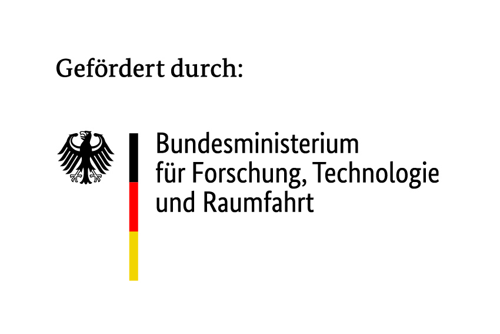
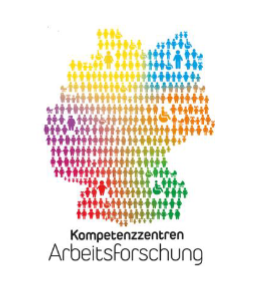

# teach-by-showing

A visitor steers a simulated overhead crane whose load swings on a rope. From
that short demonstration a small neural network learns, within seconds, to do
the same job in the visitor's own style: cautious or brisk, depending on the
teacher. A demonstrator for an exhibition stand, not a library.

The point is the mechanism behind many industrial AI applications: people
teach by showing rather than by writing rules, and people decide what counts
as a good result.

**Status:** in development, for the K-M-I closing event on 3–4 November 2026.
It runs next to its sibling [feature-viz](https://github.com/foersterflorian/feature-viz),
one monitor each.

```bash
pdm install
pdm run pytest
pdm run teach-by-showing        # http://localhost:8081
```

On the stand the crane is driven with the left stick of a USB gamepad; for
development also with ← → or A / D. `http://localhost:8081/gamepad.html`
shows what the browser reads from a gamepad, and `tools/measure_ws.py`
measures the running server from outside — timing, input round trip, and
the command it applies (`DECISIONS.md` §8, §12):

```bash
pdm run python tools/measure_ws.py timing --seconds 30
```

On the stand it runs in a container, without GPU or devices; the browser on
the host draws the crane and reads the gamepad:

```bash
docker compose up -d                # then open http://localhost:8081
```

`tools/kiosk.py` opens the page full screen in Firefox on a chosen monitor,
picked by its EDID serial; it runs with the system Python on the host and
needs Firefox (`DECISIONS.md` §11):

```bash
python3 tools/kiosk.py list
python3 tools/kiosk.py open --serial <n>
```

`tools/udev/70-teach-by-showing-gamepad.rules` switches off the GameSir
gamepad's keyboard and mouse interface, through which its Share button
would open the desktop's screenshot dialog over the kiosk. It is installed
once on the host (`DECISIONS.md` §12):

```bash
sudo cp tools/udev/70-teach-by-showing-gamepad.rules /etc/udev/rules.d/
```

The GameSir runs in one of three modes, depending on what was pressed
(`DECISIONS.md` §12). The crane works in the default and the Xbox mode; the
stand relies on the default mode, which the pad falls back to on its own.
To see which mode it is in:

```bash
grep -i 'N: Name=.*gamesir' /proc/bus/input/devices
```

| Output | Mode | How it is reached |
|---|---|---|
| `GameSir-G7 SE Controller for Xbox` | default | plugged in, nothing pressed; LED off |
| `GameSir G7 SE` | Xbox | Menu + View + M held for 3 s while plugged in; LED on |
| `Guangzhou Chicken Run … GameSir-G7 SE Controller for Xbox` | View+Menu — wrong layout, replug | View and Menu held while plugging in; LED on |

Without a terminal, `gamepad.html` shows the same after a button press: the
id starts with `3537-1082-` (default), `3537-1010-GameSir G7 SE` (Xbox) or
`3537-1010-Guangzhou` (View+Menu). The LED alone does not tell the Xbox mode
from the View+Menu mode.

`DECISIONS.md` records why the code is shaped the way it is, including the
alternatives that were rejected. Read it before changing anything structural.

## Funding

The [K-M-I research and development project](https://kmi-netzwerk.org/kmi-projekt/) is funded as part of the “Future of Work: Regional Competence Centers for Labor Research – Artificial Intelligence” funding initiative within the “Innovations for Tomorrow's Production, Services, and Work” program of the German Federal Ministry of Research, Technology and Space (BMFTR) and is supervised by the Project Management Agency Karlsruhe (PTKA).

<p align="left">
  
  
</p>

The running demonstrator carries the same notice on screen (`DECISIONS.md`
§2).

## License

**MIT**. The full text is in [LICENSE](LICENSE). See `DECISIONS.md` §1.

The two logos in `src/teach_by_showing/funding/` are not covered by the MIT
licence. They belong to their respective owners and are included, unmodified,
solely to meet the funding acknowledgement requirement.

Dependencies are permissively licensed: NumPy, Starlette, uvicorn and
websockets (BSD-3-Clause), FastAPI and pydantic (MIT), and their own
dependencies (MIT, BSD-3-Clause, PSF-2.0).
